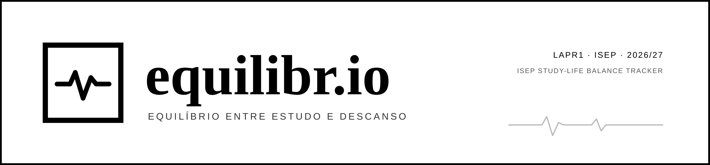
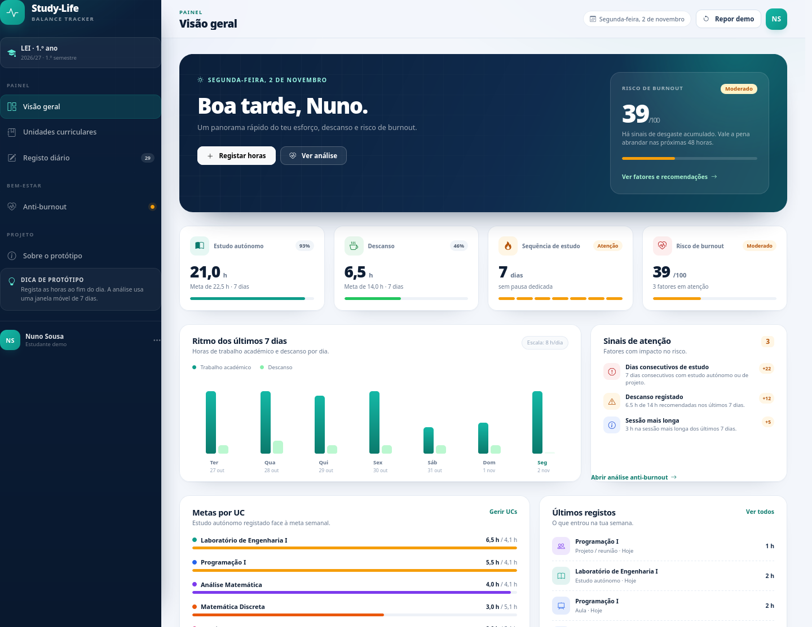
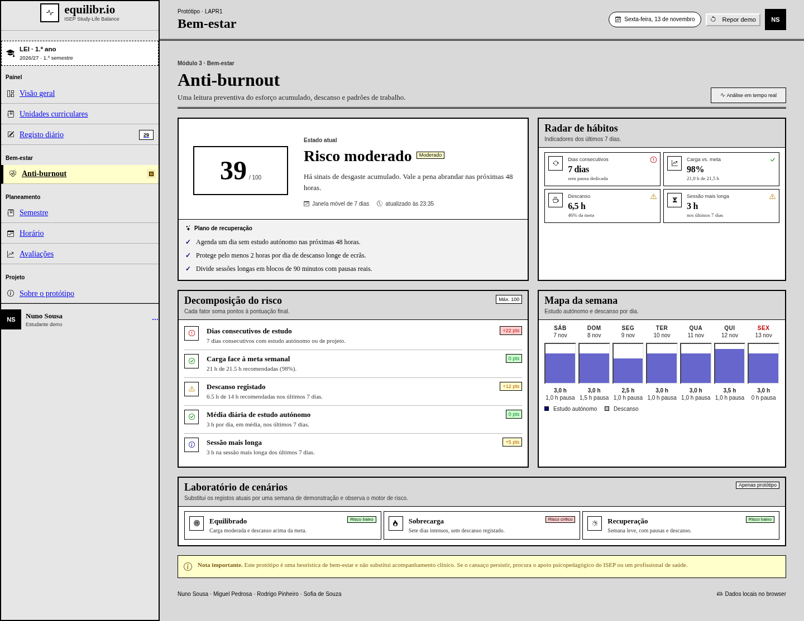
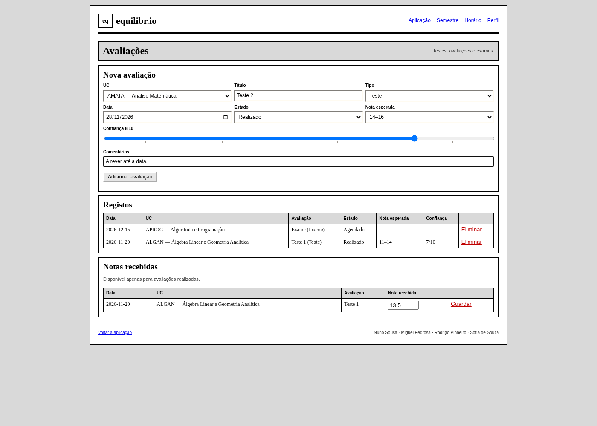
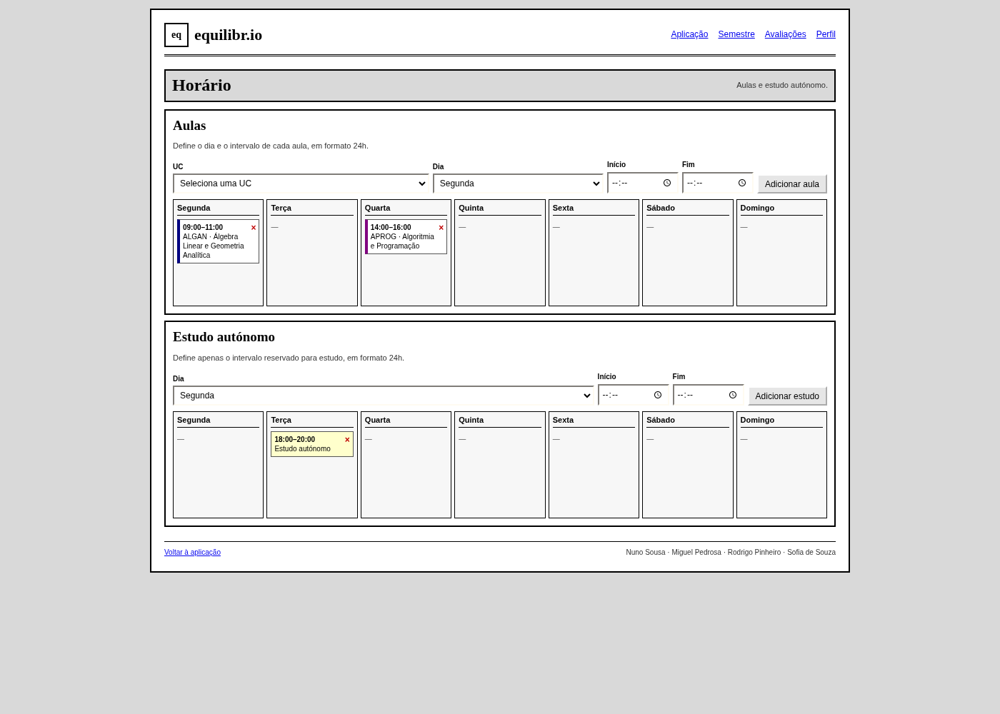
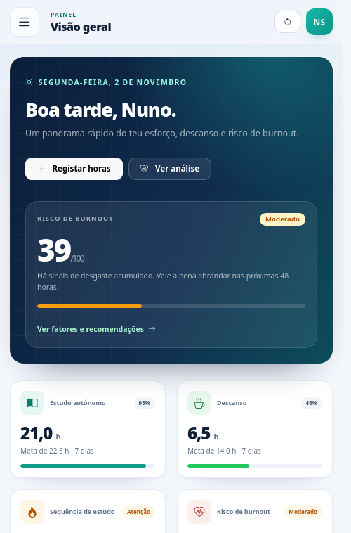
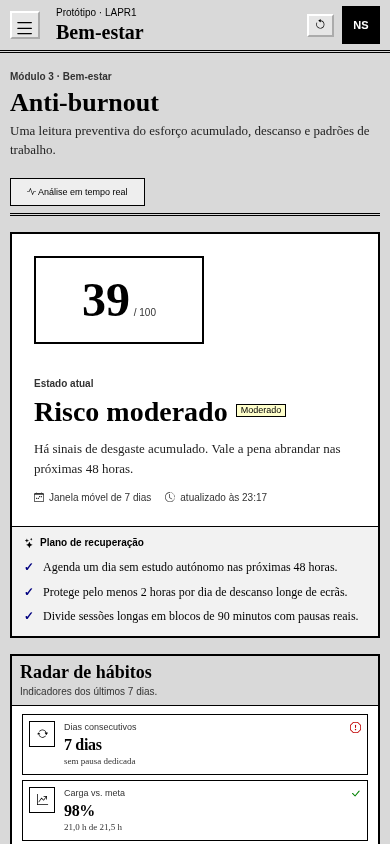
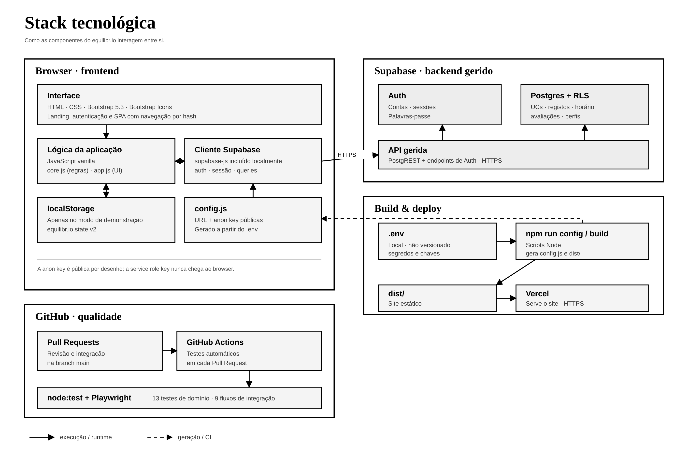

<p align="center">
  
</p>

<p align="center">
  <b>ISEP Study-Life Balance Tracker</b> · protótipo académico · LAPR1 2026/27<br />
  Grupo <b>Quarteto Maravilha</b>
</p>

O **equilibr.io** transforma a carga letiva em metas semanais de estudo autónomo, permite registar a atividade diária e calcula um indicador preventivo de risco de burnout. É um protótipo académico: não é uma aplicação oficial do ISEP nem substitui acompanhamento clínico.



<p align="center">
  <a href="docs/DESENVOLVIMENTO.md"><b>Como executar</b></a> ·
  <a href="docs/PROCESSO.md">Processo</a> ·
  <a href="docs/BACKEND.md">Backend</a> ·
  <a href="docs/screenshots/">Capturas</a>
</p>

## Índice

- [Sobre o projeto](#sobre-o-projeto)
- [Funcionalidades](#funcionalidades)
- [Regras de cálculo](#regras-de-cálculo)
- [Vistas](#vistas)
- [Stack tecnológica](#stack-tecnológica)
- [Limitações](#limitações)
- [Equipa](#equipa)
- [Documentação](#documentação)
- [Estatísticas](#estatísticas)

## Sobre o projeto

O relatório do Sprint 1 descreve uma aplicação de consola com três módulos:

1. **Gestão de ECTS** — converte créditos em horas semanais e desconta as horas de contacto.
2. **Registo diário** — regista aulas, estudo autónomo, projeto e descanso por unidade curricular.
3. **Anti-burnout** — analisa a atividade recente e sinaliza sobrecarga e falta de descanso.

Este protótipo mantém as mesmas regras de negócio, mas adapta os fluxos a uma interface web navegável. A versão atual já inclui Supabase para autenticação, perfil, UCs, registos, horário e avaliações. A justificação desta adaptação está documentada em [`docs/PROCESSO.md`](docs/PROCESSO.md).

| Item | Valor |
| --- | --- |
| Unidade curricular | LAPR1 2026/27 |
| Turma | LAPR1-2627-DKL01-Skills |
| Grupo | Quarteto Maravilha |
| Elementos | Nuno Sousa, Miguel Pedrosa, Rodrigo Pinheiro e Sofia de Souza |
| Fonte funcional | `Relatório 1 - SPRINT 1 (1).pdf` |

## Funcionalidades

### Painel e ECTS

- Cartão de risco de burnout com pontuação de 0 a 100 e nível qualitativo.
- Indicadores de estudo autónomo, descanso, sequência de estudo e risco.
- Gráfico dos últimos sete dias com trabalho académico e descanso.
- Criação, edição e eliminação de UCs, com cálculo automático da meta autónoma.
- Totais de ECTS, carga semanal, horas de contacto e estudo autónomo.
- UCs do catálogo e UCs personalizadas por utilizador.

### Registo diário

- Aulas, estudo autónomo, projeto/reunião e descanso.
- Associação a uma UC, exceto para descanso, que é transversal.
- Durações rápidas de 30, 60, 90 e 120 minutos.
- Histórico filtrável por período, UC e tipo, com resumos do período.
- Validação de datas futuras, durações e campos obrigatórios.

### Anti-burnout

- Pontuação de 0 a 100 calculada a partir de cinco fatores.
- Níveis **Baixo**, **Moderado**, **Elevado** e **Crítico**.
- Decomposição da pontuação por fator, com pontos e explicação.
- Recomendações geradas a partir dos fatores com pontuação positiva.
- Radar de hábitos, mapa semanal e laboratório de cenários.

### Semestre, horário e avaliações

- Escolha de semestre e UCs a partir do catálogo.
- Aulas e blocos de estudo autónomo por dia e intervalo.
- Vista semanal de segunda a domingo, em formato 24h.
- Testes, avaliações e exames, com nota esperada e confiança de 0 a 10.
- Registo posterior da nota recebida.

### Conta e experiência

- Login, registo e perfil com Supabase Auth.
- Sessão persistente e dados por utilizador.
- Modo de demonstração local sem conta.
- Navegação SPA por hash, layout responsivo com menu offcanvas em mobile.
- Conteúdo em português europeu (pt-PT).

## Regras de cálculo

### Meta de estudo autónomo

A explicação completa está em [`docs/META_AUTONOMA.md`](docs/META_AUTONOMA.md).

O modelo assume:

- **1 ECTS = 27 horas** de trabalho total.
- **Semestre = 20 semanas**.
- A meta autónoma desconta as horas de contacto semanais (aulas, laboratórios e tutoriais), não uma estimativa de estudo autónomo.

```text
carga semanal da UC = (ECTS × 27) ÷ 20
meta autónoma da UC = max(0, carga semanal da UC − horas de contacto)
```

Exemplo: uma UC de 6 ECTS com 4 horas de contacto semanais tem uma carga total de 8,1 h e uma meta autónoma de 4,1 h por semana.

A meta global é a soma das metas de todas as UCs.

### Janela de análise

Os indicadores de estudo, descanso, sequência e risco usam uma **janela móvel de sete dias**: hoje e os seis dias anteriores. Esta escolha evita que o risco pareça artificialmente baixo no início da semana e reflete o esforço recente.

### Motor anti-burnout

A pontuação é uma soma de cinco fatores, limitada ao intervalo 0–100.

| Fator | Condição | Pontos máximos |
| --- | --- | ---: |
| Dias consecutivos de estudo | ≥ 10 dias: 30 · 7–9: 22 · 5–6: 12 · 3–4: 4 | 30 |
| Carga face à meta semanal | ≥ 150%: 30 · 125–149%: 20 · 110–124%: 10 | 30 |
| Descanso registado | < 25% da meta: 20 · 25–49%: 12 · 50–74%: 6 | 20 |
| Média diária de estudo autónomo | ≥ 7 h: 15 · 5–6,9 h: 8 | 15 |
| Sessão mais longa | ≥ 4 h: 10 · 3–3,9 h: 5 | 10 |

A meta de descanso predefinida é de **14 horas por semana**.

| Pontuação | Nível |
| --- | --- |
| 0–24 | Baixo |
| 25–49 | Moderado |
| 50–74 | Elevado |
| 75–100 | Crítico |

O motor apresenta recomendações quando um fator soma pontos. A pontuação é uma heurística de bem-estar, não um diagnóstico nem um instrumento clínico. A fundamentação está em [`docs/MODELO_BURNOUT.md`](docs/MODELO_BURNOUT.md).

## Vistas

### Desktop

<table>
  <tr>
    <td align="center" width="33%">
      <a href="docs/screenshots/burnout.png"></a><br />
      <sub><b>Anti-burnout</b></sub>
    </td>
    <td align="center" width="33%">
      <a href="docs/screenshots/assessments.png"></a><br />
      <sub><b>Avaliações</b></sub>
    </td>
    <td align="center" width="33%">
      <a href="docs/screenshots/schedule.png"></a><br />
      <sub><b>Horário</b></sub>
    </td>
  </tr>
</table>

### Mobile

<table align="center">
  <tr>
    <td align="center" width="200">
      <a href="docs/screenshots/mobile-dashboard.png"></a><br />
      <sub><b>Dashboard</b></sub>
    </td>
    <td align="center" width="200">
      <a href="docs/screenshots/mobile-burnout.png"></a><br />
      <sub><b>Anti-burnout</b></sub>
    </td>
  </tr>
</table>

Mais capturas em [`docs/screenshots/`](docs/screenshots/).

## Stack tecnológica



O frontend é **HTML, CSS e JavaScript vanilla** com **Bootstrap 5.3** local. O **Supabase** trata da autenticação e dos dados em Postgres com RLS. Os scripts Node geram a configuração pública e o build estático para a **Vercel**. **GitHub Actions** e **Playwright** asseguram os testes automáticos.

Detalhes de arquitetura, execução local, testes e deploy em [`docs/DESENVOLVIMENTO.md`](docs/DESENVOLVIMENTO.md).

## Limitações

- O risco é uma heurística de bem-estar, não uma avaliação clínica.
- O motor de burnout ainda usa apenas `activity_logs`: não integra os blocos de estudo planeados (`study_blocks`) nem a pressão e a incerteza das avaliações (`assessments`). Ver [#21](https://github.com/mPedrosaa/equilibr.io/issues/21).
- O planeamento é manual: o horário permite criar blocos de estudo, mas ainda não sugere nem preenche automaticamente intervalos com base nas aulas, metas e avaliações. Ver [#22](https://github.com/mPedrosaa/equilibr.io/issues/22).
- Não existem exportação, notificações, integração com calendário ou lembretes.
- O protótipo não implementa a aplicação de consola descrita no relatório; valida os fluxos numa interface web.
- A suite Selenium histórica não está incluída no repositório; a suite Playwright cobre os fluxos principais.

## Equipa

<table>
  <tr>
    <td align="center" width="25%">
      <a href="https://github.com/mPedrosaa">
        <br />
        <sub><b>Miguel Pedrosa</b></sub>
      </a>
    </td>
    <td align="center" width="25%">
      <a href="https://github.com/nuno2939">
        <br />
        <sub><b>Nuno Sousa</b></sub>
      </a>
    </td>
    <td align="center" width="25%">
      <a href="https://github.com/Pinheiro1379">
        <br />
        <sub><b>Rodrigo Pinheiro</b></sub>
      </a>
    </td>
    <td align="center" width="25%">
      <a href="https://github.com/Soleluae">
        <br />
        <sub><b>Sofia de Souza</b></sub>
      </a>
    </td>
  </tr>
</table>

Trabalho desenvolvido no âmbito de **LAPR1 2026/27**, turma **LAPR1-2627-DKL01-Skills**, pelo grupo **“Quarteto Maravilha”**.

## Documentação

- [`docs/DESENVOLVIMENTO.md`](docs/DESENVOLVIMENTO.md) — execução local, arquitetura, stack, estrutura, testes, deploy e dados de demonstração.
- [`docs/BACKEND.md`](docs/BACKEND.md) — configuração do Supabase, migrations e seed.
- [`docs/PROCESSO.md`](docs/PROCESSO.md) — análise do relatório, requisitos, decisões, modelo de dados, implementação, QA e roadmap.
- [`docs/MODELO_BURNOUT.md`](docs/MODELO_BURNOUT.md) — fundamentação do modelo de risco, pressupostos, utilidade e limites.
- [`docs/META_AUTONOMA.md`](docs/META_AUTONOMA.md) — cálculo da carga total e da meta autónoma.
- [`docs/IA_GENERATIVA.md`](docs/IA_GENERATIVA.md) — transparência sobre o uso de IA generativa.
- [`docs/screenshots/`](docs/screenshots/) — evidências visuais desktop e mobile.

## Transparência sobre IA generativa

Foram usadas ferramentas de IA generativa como apoio ao desenvolvimento, de forma regulada e supervisionada, para acelerar implementação, documentação e revisão. As sugestões foram sempre revistas, testadas e adaptadas pela equipa. A responsabilidade final pelo código e pelas decisões técnicas é humana. Detalhes em [`docs/IA_GENERATIVA.md`](docs/IA_GENERATIVA.md).

## Estatísticas


<p align="center">
  <a href="https://star-history.com/#mPedrosaa/equilibr.io&amp;Date">
    
  </a>
</p>

Badges e gráfico atualizados automaticamente a partir do GitHub. Não é necessário fazer commit para atualizar estas estatísticas.

Protótipo académico independente. Não é uma aplicação oficial do ISEP.
