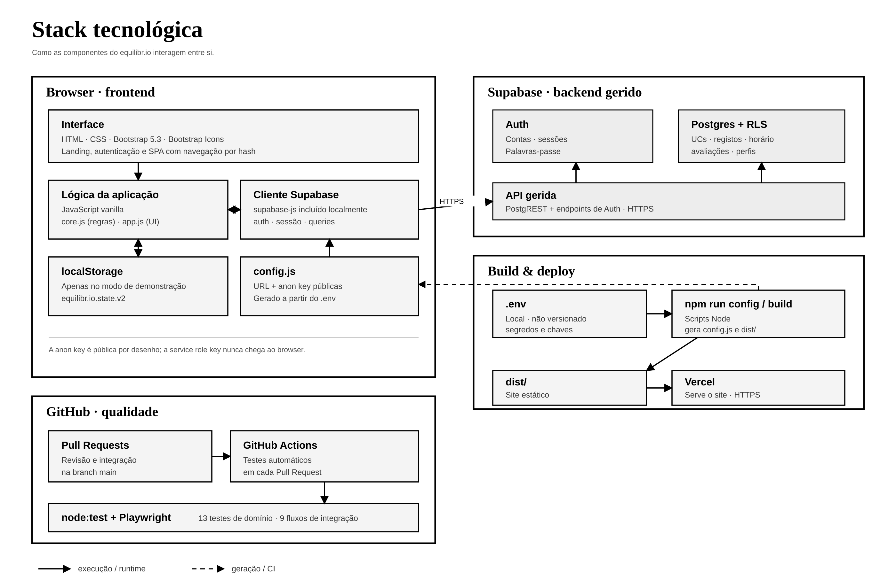

# Desenvolvimento e operação

Documento técnico do **equilibr.io**. Reúne execução local, arquitetura,
estrutura, decisões, testes, deploy e dados de demonstração. Para a visão
funcional e as regras de negócio, ver o [`README.md`](../README.md).

## Requisitos

- Browser moderno com JavaScript, CSS custom properties e `Intl`.
- Python 3 ou Node.js para servir os ficheiros localmente.
- Node.js 18 ou superior para os testes de domínio.
- Conta e projeto Supabase para os fluxos de autenticação e persistência.

## Execução local

A execução local não exige build. O deploy usa um build estático para `dist/` e
não existe backend próprio: autenticação e persistência usam Supabase.
Bootstrap, Bootstrap Icons e o cliente Supabase estão incluídos em
`assets/vendor/`.

### Servidor HTTP local (recomendado)

```bash
python3 -m http.server 8000
```

Abrir `http://localhost:8000`. A raiz apresenta a landing page; a aplicação
está em `app.html` e o acesso em `login.html`.

Também pode ser usado qualquer servidor estático:

```bash
npx serve .
```

### Abrir diretamente

`index.html`, `login.html`, `register.html` e `app.html` também podem ser
abertos diretamente no browser. O servidor local é recomendado para garantir um
comportamento consistente do `localStorage` entre sessões.

## Configuração do Supabase

O browser não lê o `.env`: a configuração pública é gerada por scripts Node e
fica em `assets/js/config.js` (ignorado pelo Git).

```bash
cp .env.example .env
# preencher SUPABASE_URL, SUPABASE_ANON_KEY, SUPABASE_SERVICE_ROLE_KEY
# e SUPABASE_ACCESS_TOKEN
npm run config
npm run db:setup
```

O seed insere as UCs de LEI — 1.º ano, 1.º semestre: **ALGAN**, **APROG**,
**AMATA**, **LAPR1** e **PRCMP**.

A `SUPABASE_SERVICE_ROLE_KEY` é usada apenas pelo script de seed e nunca deve
ser colocada no frontend. O deploy da Vercel gera `dist/assets/js/config.js`
automaticamente a partir das variáveis de ambiente do projeto. O guia completo
está em [`BACKEND.md`](./BACKEND.md).

## Build e deploy

O projeto não tem backend próprio. O build estático:

1. copia as páginas e `assets/` para `dist/`;
2. gera `dist/assets/js/config.js` a partir das variáveis de ambiente;
3. é publicado pela Vercel como site estático.

```bash
npm run build
```

A configuração de deploy está em `vercel.json` (`buildCommand: npm run build`,
`outputDirectory: dist`).

## Stack



- **HTML + Bootstrap 5.3.3 + JavaScript vanilla.** Não há React, Vue ou outra
  framework de UI; o protótipo mantém-se leve e fácil de inspecionar.
- **Assets locais.** Bootstrap, Bootstrap Icons e o cliente Supabase estão em
  `assets/vendor/`, permitindo executar o protótipo sem depender de CDNs.
- **SPA com hash routing.** Funciona em qualquer servidor estático, sem regras
  de rewrite.
- **Supabase.** Auth para contas e sessões, Postgres com RLS para os dados e
  PostgREST para as queries.
- **`localStorage` com a chave `equilibr.io.state.v2`.** Só é usado no modo de
  demonstração; com login, registos, UCs, horário e avaliações vêm do Supabase.
- **Gráficos em CSS.** Não foi adicionada uma biblioteca de charts; os gráficos
  são barras, gauge, heatmap e progressos construídos com HTML/CSS.
- **Dados demo relativos à data atual.** O cenário inicial é recalculado no
  arranque para que a demonstração continue coerente em qualquer dia.
- **Confirmação antes de ações destrutivas.** Eliminar UCs, eliminar registos e
  repor a demo usam um modal comum.

## Estrutura do projeto

```text
.
├── index.html                     # Landing page
├── login.html                     # Ecrã de entrada
├── register.html                  # Criação de conta
├── profile.html                   # Edição do perfil autenticado
├── semester.html                  # Escolha de semestre e UCs
├── schedule.html                  # Horário de aulas e estudo
├── assessments.html               # Avaliações e exames
├── app.html                       # Shell, vistas, modais e conteúdo estático
├── assets/
│   ├── css/
│   │   ├── landing.css            # Estilo mínimo da landing e do login
│   │   ├── workspace.css          # Grelhas de horário e tabelas
│   │   └── styles.css             # Design system, componentes e responsividade
│   ├── js/
│   │   ├── core.js                # Regras de negócio puras e motor de risco
│   │   ├── data.js                # UCs mock, dados demo e cenários
│   │   ├── app.js                 # Rotas, estado, renderização e CRUD
│   │   ├── auth.js                # Login e registo com Supabase
│   │   ├── supabase-client.js     # Cliente Supabase partilhado
│   │   ├── account.js             # Utilizador autenticado na aplicação
│   │   ├── profile.js             # Edição de nome, email e palavra-passe
│   │   ├── semester.js            # Escolha de semestre e UCs
│   │   ├── schedule.js            # Aulas e estudo autónomo
│   │   ├── assessments.js         # Avaliações e exames
│   │   ├── workspace-common.js    # Sessão e catálogo comuns
│   │   └── config.js              # Configuração pública gerada a partir do .env
│   └── vendor/
│       ├── bootstrap/             # Bootstrap 5.3.3 local
│       ├── bootstrap-icons/       # Ícones locais
│       └── supabase/              # Cliente Supabase local
├── scripts/
│   ├── env.mjs                    # Leitura simples do ficheiro .env
│   ├── apply-migrations.mjs       # Aplica as migrations via Management API
│   ├── build-static.mjs           # Gera dist/ e a config para Vercel
│   ├── config.mjs                 # Conteúdo da configuração pública
│   ├── generate-config.mjs        # Gera assets/js/config.js a partir do ambiente
│   └── seed-courses.mjs           # Semeia as UCs de LEI no Supabase
├── supabase/
│   └── migrations/                # Esquema, triggers, RLS e evolução do modelo
├── tests/
│   ├── core.test.js               # 13 testes de domínio com Node.js
│   └── integration/
│       ├── app.spec.js            # 4 testes de integração da aplicação
│       └── landing.spec.js        # 5 testes da landing, login, perfil e registo
├── .github/workflows/pr-tests.yml # Testes automáticos em Pull Requests
├── docs/                          # Documentação técnica e evidências visuais
├── package.json                   # Dependências de desenvolvimento e scripts
├── playwright.config.js           # Configuração dos testes de integração
├── vercel.json                    # Build e output do deploy estático
├── .env.example                   # Variáveis de ambiente do Supabase
└── README.md
```

## Camadas

- **`core.js`** não depende do DOM nem do Bootstrap. Pode ser executado no
  browser ou em Node.js e é coberto pelos testes.
- **`data.js`** contém os dados ilustrativos, o gerador de estado inicial e os
  cenários de demonstração.
- **`app.js`** liga o estado à interface, gere rotas, `localStorage`, filtros,
  modais e toasts.
- **`styles.css`** define os tokens visuais, componentes próprios, gráficos em
  CSS e breakpoints.

## Testes

### Domínio

```bash
npm test
```

Resultado atual: **13 testes concluídos com sucesso**. Cobrem datas e janela
móvel, conversão ECTS, metas por UC, dados iniciais, cenários, sequência de
estudo, limites da pontuação e casos de meta zero.

### Integração

Os testes de integração usam Playwright com Chromium:

```bash
npm ci
npx playwright install chromium
npm run test:integration
```

Cobrem nove fluxos: landing, login/demonstração local, perfil sem sessão,
páginas de planeamento sem sessão, registo com validação de palavra-passe,
dashboard, navegação e totais das UCs, criação/persistência de um registo e
cenário de sobrecarga.

Os testes de domínio e integração correm automaticamente em **GitHub Actions**
em cada Pull Request para `main`, através de
[`.github/workflows/pr-tests.yml`](../.github/workflows/pr-tests.yml).

## Dados de demonstração

No primeiro arranque, o protótipo cria automaticamente um cenário demonstrativo
relativo à data atual.

| Indicador | Valor inicial |
| --- | --- |
| Unidades curriculares | 5 |
| ECTS inscritos | 30 |
| Horas de contacto semanais | 19 h |
| Carga total semanal | 40,5 h |
| Meta de estudo autónomo | 21,5 h |
| Estudo autónomo registado | 21,0 h |
| Descanso registado | 6,5 h |
| Sequência de estudo | 7 dias |
| Risco de burnout | 39/100 · Moderado |

O botão **Repor demo** repõe as UCs, os registos e o perfil de demonstração. A
reposição substitui os dados existentes e pede confirmação.

### Cenários disponíveis

O laboratório de cenários substitui apenas os registos dos últimos sete dias.
As unidades curriculares mantêm-se.

| Cenário | Estudo autónomo | Descanso | Sequência | Risco | Nível |
| --- | ---: | ---: | ---: | ---: | --- |
| Base | 21,0 h | 6,5 h | 7 dias | 39 | Moderado |
| Equilibrado | 16,0 h | 15,5 h | 6 dias | 12 | Baixo |
| Sobrecarga | 37,0 h | 0 h | 7 dias | 90 | Crítico |
| Recuperação | 7,0 h | 20,5 h | 1 dia | 0 | Baixo |

Os cenários servem para validar os limites do motor de risco e não representam
dados reais de estudantes.

## Verificação visual e QA histórica

As capturas em [`docs/screenshots/`](./screenshots/) incluem as cinco vistas da
aplicação, as versões mobile, a landing, login, registo, perfil, semestre,
horário e avaliações.

Durante o desenvolvimento foi executada uma suite de **30 verificações
Selenium** em Firefox headless, com **0 erros JavaScript**, cobrindo dashboard,
UCs, metas, registos, persistência, cenários, validação de formulários e menu
mobile. A suite foi uma ferramenta de QA do ambiente de desenvolvimento e não
foi versionada; a cobertura de integração atual é assegurada pela suite
Playwright.
